# Digital Banking Payment & Transaction Platform

A hands-on **Java 17 / Spring Boot digital banking platform** implementing event-driven microservices with **Apache Kafka**, **PostgreSQL**, the **Transactional Outbox Pattern**, **Saga compensation**, **consumer and account-level idempotency**, and **real IBM MQ/JMS request-reply integration**.

The project simulates a banking payment flow from payment initiation through fraud screening, account movement, ledger posting, IBM MQ core-banking integration, payment completion, and notification.

---

## Architecture


### Implemented End-to-End Flow

```text
Client / Postman
      |
      v
Payment Service (8083)
      |
      | Save Payment = PENDING
      | Save PAYMENT_CREATED to Outbox
      v
paymentdb
payments + outbox_events
      |
      v
OutboxPublisher
      |
      v
Kafka: payment-created
      |
      v
Fraud Service (8084)
      |
      +-------------------------------+
      |                               |
      | APPROVED                      | REJECTED
      v                               v
Kafka: payment-approved          Kafka: payment-rejected
      |                               |
      v                               v
Payment Service                  Payment Service
      |                          status = REJECTED
      |                          Notification Service
      |
      | debit source account
      | credit target account
      v
status = FUNDS_TRANSFERRED
      |
      | Outbox
      v
Kafka: funds-transferred
      |
      v
Ledger Service (8085)
      |
      | Persist ledger transaction
      v
ledgerdb
      |
      v
Kafka: ledger-updated
      |
      v
Integration Service (8087)
      |
      | Build CoreBankingRequest
      | JSON serialization
      v
JmsTemplate
      |
      v
IBM MQ - QM1
DEV.QUEUE.1  (REQUEST)
      |
      v
Core Banking Simulator (8088)
      |
      | Process request
      | Build CoreBankingResponse
      v
IBM MQ - QM1
DEV.QUEUE.2  (RESPONSE)
      |
      v
Integration Service
@JmsListener
      |
      +-------------------------------+
      |                               |
      | SUCCESS                       | FAILURE
      v                               v
Kafka: core-processed            Kafka: core-failed
      |
      v
Payment Service
status = COMPLETED
      |
      | Outbox
      v
Kafka: notification-events
      |
      v
Notification Service (8086)
      |
      v
notificationdb
```

---

## Services

| Service | Port | Responsibility |
|---|---:|---|
| Customer Service | `8081` | Customer data and validation |
| Account Service | `8082` | Accounts, balances, debit/credit and account-operation idempotency |
| Payment Service | `8083` | Payment lifecycle, Outbox, Saga compensation, final payment state |
| Fraud Service | `8084` | Fraud validation and approval/rejection events |
| Ledger Service | `8085` | Ledger posting and reversal records |
| Notification Service | `8086` | Persist final success/rejection/reversal notifications |
| Integration Service | `8087` | Kafka-to-IBM-MQ and IBM-MQ-to-Kafka integration |
| Core Banking Simulator | `8088` | Simulates the legacy/core banking processor behind IBM MQ |

---

## PostgreSQL

PostgreSQL 16 runs locally in Docker.

```text
Container: banking-postgres
Host port: 5433
Container port: 5432
Username: banking
Password: supplied through DB_PASSWORD
```

Databases used:

```text
customerdb
accountdb
paymentdb
ledgerdb
notificationdb
integrationdb
```

Example configuration:

```properties
spring.datasource.url=jdbc:postgresql://localhost:5433/paymentdb
spring.datasource.username=banking
spring.datasource.password=${DB_PASSWORD}
```

---

## Apache Kafka

Kafka runs locally in Docker.

```text
Container: banking-kafka
Bootstrap server: localhost:9092
```

### Topics

```text
payment-created
payment-approved
payment-rejected
funds-transferred
ledger-updated
core-processed
core-failed
notification-events
payment-reversed
payment-retry
payment-dlq
```

An older local test topic may also exist:

```text
payment-events
```

### Local Topic Configuration

```text
Partitions: 3
Replication factor: 1
```

Events are published with `paymentId` / aggregate ID as the Kafka key so events for the same payment remain ordered within a topic partition.

---

## Payment Creation

A payment is created as `PENDING`.

```text
POST /api/payments
        |
        v
Check request idempotency key
        |
        v
Validate source account
        |
        v
Validate target account
        |
        v
Save Payment = PENDING
        +
Save PAYMENT_CREATED OutboxEvent
        |
        v
Return payment
```

The Payment Service does **not** debit or credit the accounts during initial payment creation. Fraud screening happens first.

---

## Fraud Processing

Fraud Service consumes:

```text
payment-created
```

Current project rule:

```text
amount <= 10000
    -> PAYMENT_APPROVED
    -> payment-approved

amount > 10000
    -> PAYMENT_REJECTED
    -> payment-rejected
```

A rejected payment does not enter the account-transfer, ledger, or IBM MQ flow.

---

## Approved Payment Processing

Payment Service consumes:

```text
payment-approved
```

Then:

```text
Load payment
    |
    v
Check eventId idempotency
    |
    v
Check payment status
    |
    v
Debit source account
    |
    v
Credit target account
    |
    +--> success
    |       |
    |       v
    |   FUNDS_TRANSFERRED
    |       |
    |       v
    |   Outbox -> funds-transferred
    |
    +--> credit failure
            |
            v
      Credit source back
            |
            +--> COMPENSATED
            |
            +--> COMPENSATION_FAILED
```

---

## Idempotency

The project implements multiple idempotency layers.

### 1. Payment Request Idempotency

`PaymentRequest.idempotencyKey` prevents duplicate payment creation.

```text
Same idempotencyKey
       |
       v
Return existing payment
```

### 2. Kafka Event Idempotency

Processed Kafka event IDs are stored in:

```text
processed_events
```

Before processing a Kafka event:

```text
eventId already exists?
    YES -> ignore duplicate
    NO  -> continue
```

### 3. Payment-State Idempotency

Before moving money, Payment Service checks the payment status.

Already-processed states such as:

```text
FUNDS_TRANSFERRED
COMPLETED
REVERSED
COMPENSATED
COMPENSATION_FAILED
REJECTED
```

are not processed again.

### 4. Account Operation Idempotency

Account Service stores money-movement operation IDs in:

```text
processed_account_operations
```

Example operation IDs:

```text
PAYMENT-25-DEBIT
PAYMENT-25-CREDIT
PAYMENT-25-COMPENSATION
PAYMENT-25-REVERSAL-DEBIT-TARGET
PAYMENT-25-REVERSAL-CREDIT-SOURCE
```

Payment Service sends the operation ID in:

```text
X-Operation-Id
```

If the same REST request is retried, Account Service detects the existing operation and does not change the balance again.

---

## Saga Compensation

If the source debit succeeds but target credit fails:

```text
Debit source
    |
    v
Credit target fails
    |
    v
Credit source back
    |
    +--> success -> COMPENSATED
    |
    +--> failure -> COMPENSATION_FAILED
```

No distributed two-phase commit is used.

The platform uses:

```text
Local ACID transactions
+ Transactional Outbox
+ Kafka
+ Saga compensation
+ Idempotency
```

---

## Transactional Outbox Pattern

Payment and Outbox events are stored in the same local database transaction.

```text
@Transactional
      |
      +--> save Payment
      |
      +--> save OutboxEvent = PENDING
```

This prevents the failure case where the payment is committed but the event is lost before Kafka receives it.

### Outbox Publisher

Spring scheduling is enabled and the `OutboxPublisher` periodically polls the outbox table.

```text
@EnableScheduling
        |
        v
@Scheduled
        |
        v
find PENDING events
        |
        v
KafkaTemplate.send(...)
        |
        v
Kafka acknowledgement
        |
        +--> success -> SENT
        |
        +--> failure -> retryCount + 1
```

Outbox reliability fields:

```text
retryCount
lastError
lastAttemptAt
sentAt
```

After the configured maximum retry count is reached:

```text
status = FAILED
```

The event remains in the outbox table for investigation and controlled replay.

A failed event can later be reset to:

```text
status = PENDING
retryCount = 0
```

after the root cause is fixed, allowing the existing `OutboxPublisher` to publish it again.

---

## Kafka Retry and DLQ

Fraud Service includes a Spring Kafka `DefaultErrorHandler`.

Current retry configuration:

```text
Backoff: 2 seconds
Retries: 2
Total processing attempts: 3
```

Flow:

```text
Kafka message
    |
    v
Consumer processing
    |
    +--> success -> continue
    |
    +--> failure
            |
            v
          retry
            |
            v
          retry
            |
            v
      payment-dlq
```

The project uses a `DeadLetterPublishingRecoverer` to route exhausted consumer failures to:

```text
payment-dlq
```

Outbox publishing failures and Kafka consumer failures are intentionally handled differently:

```text
Outbox publish failure
-> FAILED row remains in outbox table

Kafka consumer failure
-> retry
-> payment-dlq after retry exhaustion
```

---

## Ledger Service

Ledger Service consumes:

```text
funds-transferred
```

It persists an immutable ledger transaction in:

```text
ledger_transactions
```

Then publishes:

```text
LEDGER_UPDATED
-> ledger-updated
```

The ledger event starts the integration flow toward IBM MQ.

For reversals, a new reversal ledger entry is created rather than deleting the original ledger transaction.

---

## IBM MQ / JMS Integration

IBM MQ is real in this project. Only the external/core banking application is simulated.

### IBM MQ Docker Container

```text
Container: banking-mq
Queue Manager: QM1
Connection: localhost(1414)
Channel: DEV.APP.SVRCONN
User: app
Password: supplied through MQ_PASSWORD
Web console: https://localhost:9443
```

Spring configuration:

```properties
ibm.mq.queueManager=QM1
ibm.mq.channel=DEV.APP.SVRCONN
ibm.mq.connName=localhost(1414)
ibm.mq.user=app
ibm.mq.password=${MQ_PASSWORD}
```

### Request Queue

```text
DEV.QUEUE.1
```

Used by:

```text
Integration Service
    |
    v
JmsTemplate.convertAndSend(...)
    |
    v
DEV.QUEUE.1
    |
    v
Core Banking Simulator
```

### Response Queue

```text
DEV.QUEUE.2
```

Used by:

```text
Core Banking Simulator
    |
    v
JmsTemplate
    |
    v
DEV.QUEUE.2
    |
    v
Integration Service @JmsListener
```

### JMS Components

`JmsTemplate` is used to send messages.

```java
jmsTemplate.convertAndSend("DEV.QUEUE.1", payload);
```

`@EnableJms` enables Spring JMS listener support.

`@JmsListener` consumes messages from IBM MQ queues.

```java
@JmsListener(destination = "DEV.QUEUE.1")
```

and:

```java
@JmsListener(destination = "DEV.QUEUE.2")
```

The IBM MQ Spring Boot starter reads the `ibm.mq.*` properties and configures the underlying MQ `ConnectionFactory`.

---

## Core Banking Request / Response

Integration Service converts the Kafka `PaymentEvent` into a `CoreBankingRequest`.

Request data includes:

```text
messageId
correlationId
paymentId
paymentReference
sourceAccountNumber
targetAccountNumber
amount
currency
requestTimestamp
```

The Core Banking Simulator processes the request and sends a `CoreBankingResponse`.

Response data includes:

```text
messageId
correlationId
paymentId
paymentReference
status
message
```

Integration Service consumes the MQ response and publishes:

```text
SUCCESS -> core-processed
FAILURE -> core-failed
```

---

## Payment Completion

Payment Service consumes:

```text
core-processed
```

Then:

```text
FUNDS_TRANSFERRED
        |
        v
COMPLETED
        |
        v
PAYMENT_COMPLETED OutboxEvent
        |
        v
notification-events
```

---

## Notification Service

Notification Service consumes:

```text
notification-events
payment-rejected
```

It stores notifications in:

```text
notificationdb
```

Examples:

```text
Payment PAY-... completed successfully for 150.00 NZD
```

and:

```text
Payment PAY-... was rejected by fraud screening.
```

The successful end-to-end flow through Kafka, IBM MQ, payment completion, and notification persistence has been tested.

---

## Reversal Design

The project includes a core-banking failure reversal path.

```text
core-failed
    |
    v
Payment Service
    |
    v
Debit original target
    |
    v
Credit original source
    |
    +--> success -> REVERSED
    |
    +--> failure -> REVERSAL_FAILED
```

Reversal money movements use deterministic idempotency operation IDs so a retry cannot apply the same reversal twice.

---

## Repository Structure

```text
digital-banking-platform/
├── account-service/
├── core-banking-simulator/
├── customer-service/
├── fraud-service/
├── integration-service/
├── ledger-service/
├── notification-service/
├── payment-service/
├── docs/
│   ├── runtime-2026-10-13/  # Kafbat UI screenshots captured on 13 October
│   ├── fraud-approval-published.png
│   ├── partition-assignment-outbox-query.png
│   ├── payment-consumer-config.png
│   └── payment-json-event.png
├── Digital Banking Event Flow Architecture.png
├── Digital Banking Kafka Event Flow Architecture.png
├── Digital Banking Platform Architecture.png
├── Kafka Digital Banking Event Flow.png
└── README.md
```

---

## Kafka Runtime Evidence

The following screenshots record local execution of the Spring Boot and Kafka services on 6 October 2026.

### Payment Service Kafka configuration

Payment Service started on HTTP port `8083`. The consumer log shows bootstrap server `localhost:9092`, consumer group `payment-group`, `auto.offset.reset=earliest` and `enable.auto.commit=false`.

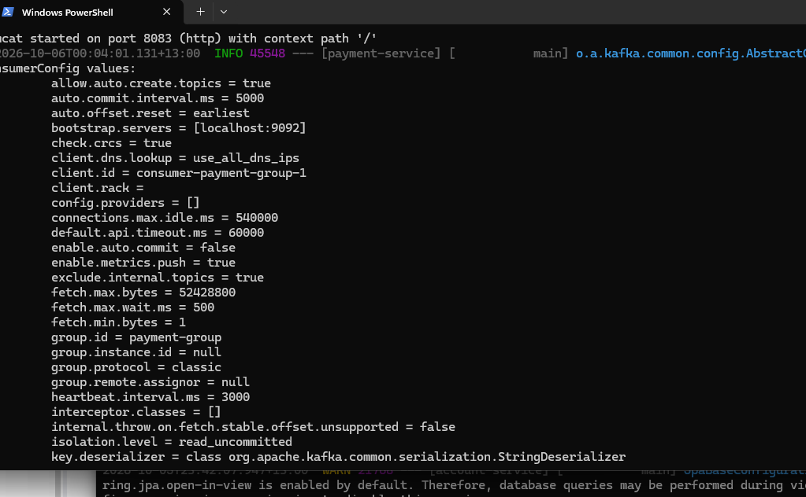

### Fraud Service event publishing

Fraud Service received a payment and logged publication to Kafka topic `payment-approved`. The Kafka producer log also shows an idempotent producer was initialized.

```text
Fraud Service received payment: PAY-11ab153c-f28b-4172-811d-ab61ce3d34f5
Fraud result published to: payment-approved
```

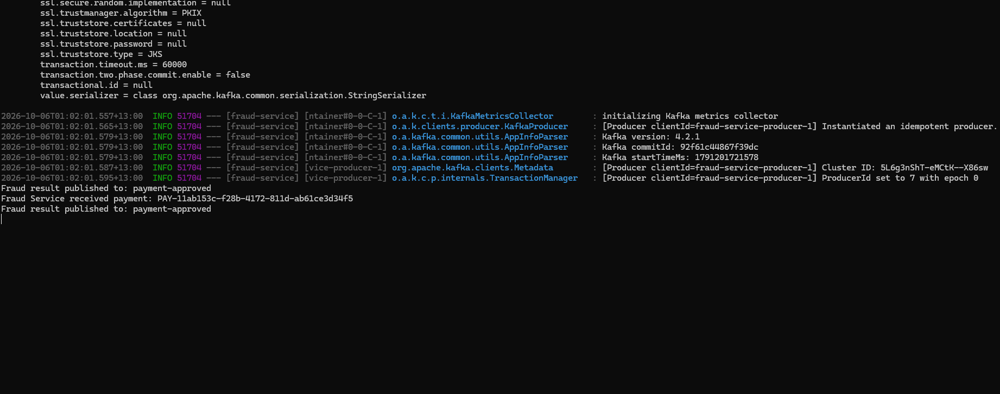

### Payment event consumption

Payment Service logged receipt of a JSON payment event containing account references, amount `500.00`, currency `NZD`, payment type `TRANSFER`, payment status `COMPLETED`, and an idempotency key.

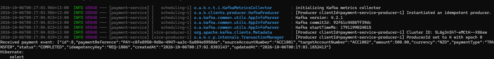

### Kafka consumer partitions and outbox polling

The consumer group `payment-group` was assigned partitions 0, 1 and 2 of the earlier test topic `payment-events`. A Hibernate SQL log also shows a query selecting pending records from `outbox_events` ordered by creation time.

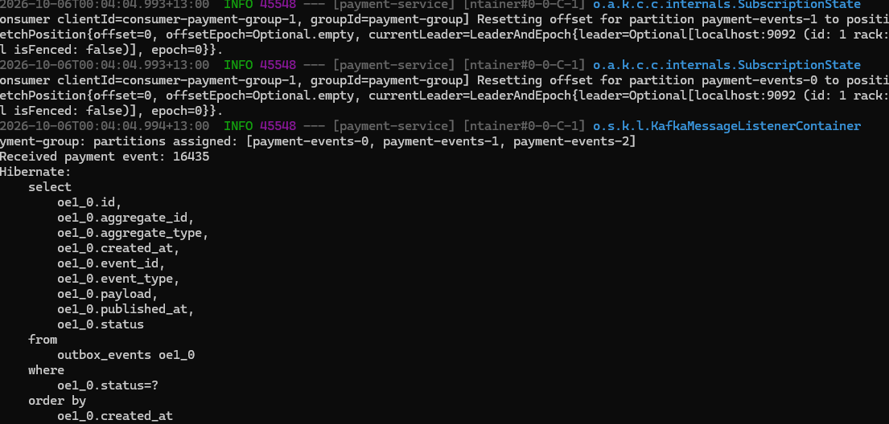

These screenshots demonstrate the particular Kafka and database operations shown in the logs. They are not, by themselves, evidence of the entire IBM MQ request/reply workflow.

---

## Kafka Monitoring and Runtime Evidence — 13 October 2026

Kafbat UI was used to inspect the local `digital-banking` Kafka cluster, topic partitions, event records and consumer groups. The screenshots below were selected from the local development captures and show the state at capture time; message counts change as payments are submitted and records expire.

### Cluster dashboard

The dashboard shows one online cluster, one broker, 13 topics and 86 partitions. The topic list includes the internal `__consumer_offsets` topic with 50 partitions and 12 application/test topics with three partitions each. The displayed Kafka version is `Unknown`.

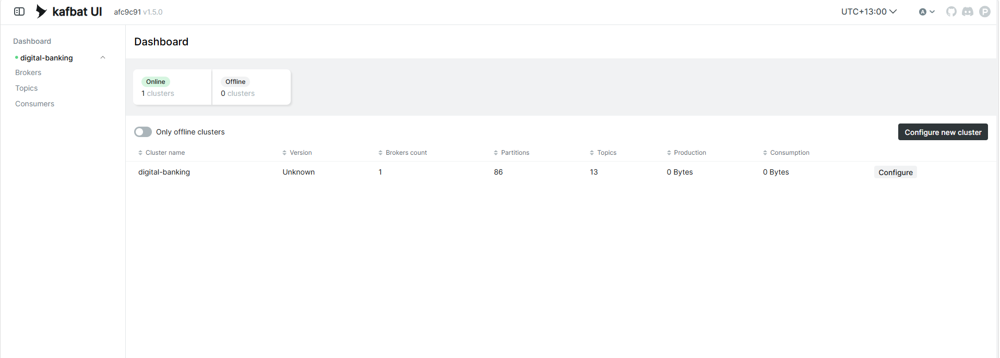

### Topics and event flow

The topics view includes `payment-created`, `payment-approved`, `payment-rejected`, `funds-transferred`, `ledger-updated`, `core-processed`, `core-failed`, `notification-events`, `payment-reversed`, `payment-retry`, `payment-dlq` and the earlier `payment-events` test topic.

At this snapshot, the UI shows records in the approval, rejection, funds-transfer, ledger, core-processed and notification topics. It also shows one record in `payment-dlq`. That DLQ count establishes that a record is present; diagnosing its cause requires inspecting the record and exception headers. The existence of `payment-retry` alone does not demonstrate that a separate retry-topic workflow is active.

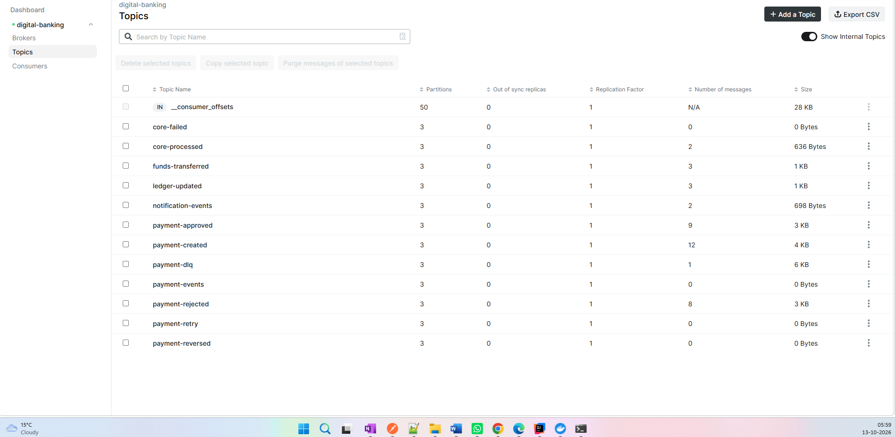

### Partitions, offsets and replication

The `payment-approved` overview shows three partitions, replication factor one, zero under-replicated partitions and 11 retained messages. Partition 0 has six messages and partition 1 has five. Partition 2 has no retained messages, with first and next offsets both equal to 2. Offsets identify positions within a partition; they are not a global message counter.

Replication factor one means the local demonstration has no redundant replica for each partition. This setup illustrates partitioning and message flow, but does not demonstrate broker-failure resilience.

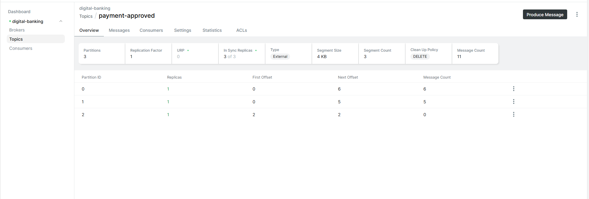

### Payment keys across approval and notification topics

The approval message list shows keys `23` and `24` on 13 October. Key `23` appears in partition 0 and key `24` in partition 1. The notification list also contains keys `23` and `24`, providing a way to follow those payment identifiers across the two topics.

| Payment key | Approval timestamp | Notification timestamp |
|---|---|---|
| `23` | 13 October 2026, 06:00:01.878 | 13 October 2026, 06:00:10.911 |
| `24` | 13 October 2026, 06:01:26.274 | 13 October 2026, 06:01:36.364 |

Times are displayed in the local UI timezone, UTC+13. These are event timestamps shown in the screenshots, not a controlled latency benchmark. Ordering is scoped to a partition within one topic; matching keys across different topics do not create a single global ordering guarantee.

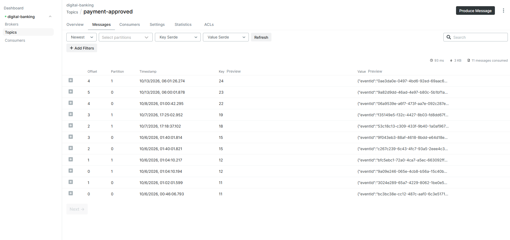

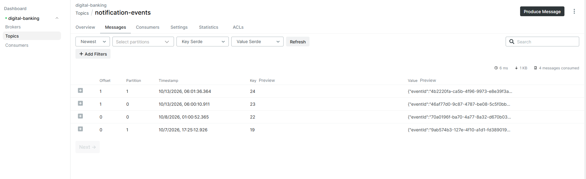

### Consumer groups and lag

| Consumer group | Topic shown | Captured state | Members / active consumers | Lag |
|---|---|---|---:|---:|
| `fraud-group` | `payment-created` | STABLE | 1 | 0 |
| `integration-group` | `ledger-updated` | STABLE | 1 | 0 |

The Integration Service group has one assigned topic and three assigned partitions. These group names also match the committed Fraud Service and Integration Service configuration.

A stable group has completed its current partition assignment. Zero reported lag means the group is caught up according to the offsets reported by the UI at that moment; it does not by itself prove successful database writes, IBM MQ replies or final payment completion.

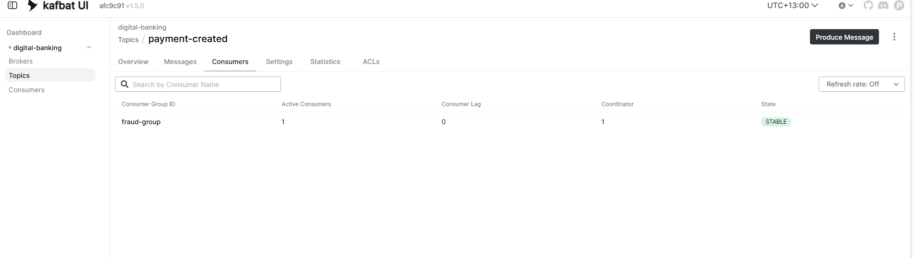

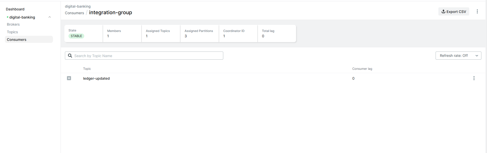

### Repeating the local inspection

1. Start the local Kafka infrastructure and relevant Spring Boot services using the configuration documented above.
2. Open the configured Kafbat UI instance and select `digital-banking`.
3. Inspect **Topics** for the event topics, partition counts and replication factor.
4. Submit a payment through `POST /api/payments` with a fresh request idempotency key, then locate its payment key in the event topics.
5. Compare the payment key in approval and notification records; inspect the intermediate topics and service logs to trace the full flow.
6. Inspect **Consumers** for group membership, assigned partitions and lag.
7. For failures, inspect `payment-dlq`, application logs and outbox rows before attempting a controlled replay.

These captures document local Kafka observability. Full end-to-end verification additionally requires the corresponding payment state, account balances, ledger entries, MQ request/reply evidence and notification persistence.

---

## Useful Kafka Commands

List topics:

```powershell
docker exec -it banking-kafka /opt/kafka/bin/kafka-topics.sh `
  --list `
  --bootstrap-server localhost:9092
```

Describe a topic:

```powershell
docker exec -it banking-kafka /opt/kafka/bin/kafka-topics.sh `
  --describe `
  --topic payment-created `
  --bootstrap-server localhost:9092
```

Consume a topic:

```powershell
docker exec -it banking-kafka /opt/kafka/bin/kafka-console-consumer.sh `
  --bootstrap-server localhost:9092 `
  --topic payment-created `
  --from-beginning `
  --property print.key=true `
  --property print.partition=true
```

Check DLQ:

```powershell
docker exec -it banking-kafka /opt/kafka/bin/kafka-console-consumer.sh `
  --bootstrap-server localhost:9092 `
  --topic payment-dlq `
  --from-beginning
```

---

## Useful PostgreSQL Commands

Payment DB:

```powershell
docker exec -it banking-postgres psql -U banking -d paymentdb
```

Account DB:

```powershell
docker exec -it banking-postgres psql -U banking -d accountdb
```

Ledger DB:

```powershell
docker exec -it banking-postgres psql -U banking -d ledgerdb
```

Notification DB:

```powershell
docker exec -it banking-postgres psql -U banking -d notificationdb
```

Check processed account operations:

```sql
SELECT *
FROM processed_account_operations
ORDER BY processed_at DESC;
```

Check processed Kafka events:

```sql
SELECT *
FROM processed_events
ORDER BY processed_at DESC;
```

Check latest Outbox events:

```sql
SELECT *
FROM outbox_events
ORDER BY created_at DESC;
```

---

## Environment Variables

Local secrets are externalized through environment variables.

Example:

```powershell
$env:DB_PASSWORD="<local-db-password>"
$env:MQ_PASSWORD="<local-mq-password>"
```

Configuration:

```properties
spring.datasource.password=${DB_PASSWORD}
ibm.mq.password=${MQ_PASSWORD}
```

Do not commit passwords or secrets to Git.

---

## Technology Stack

| Area | Technology |
|---|---|
| Language | Java 17 |
| Framework | Spring Boot |
| REST | Spring Web / RestClient |
| Persistence | Spring Data JPA / Hibernate |
| Database | PostgreSQL 16 |
| Event Streaming | Apache Kafka |
| Kafka Client | Spring for Apache Kafka |
| Enterprise Messaging | IBM MQ |
| JMS | Spring JMS / JmsTemplate / @JmsListener |
| JSON | Jackson |
| Reliability | Transactional Outbox, Retry/DLQ, Idempotency, Saga Compensation |
| Build | Maven |
| Local Infrastructure | Docker |
| API Testing | Postman |
| Kafka Inspection | Kafbat UI |
| Source Control | Git / GitHub |

---

## Implemented Reliability Patterns

```text
Transactional Outbox
Kafka keyed messages
Kafka consumer groups
Retry with backoff
Dead Letter Queue
Request idempotency
Kafka event idempotency
Payment-state idempotency
Account-operation idempotency
Saga compensation
IBM MQ request/reply
Correlation ID in core-banking request/response
```

---

## Current Implementation Status

Implemented and tested:

```text
Customer Service
Account Service
Payment Service
Fraud Service
Ledger Service
Notification Service
Integration Service
Core Banking Simulator

PostgreSQL
Apache Kafka
Transactional Outbox
Scheduled Outbox Publisher
Fraud approval/rejection
Account debit/credit
Saga compensation
Ledger persistence
IBM MQ / JMS request-response
Payment completion
Notification persistence
Payment request idempotency
Kafka event idempotency
Account operation idempotency
Basic Kafka retry/DLQ
Successful end-to-end payment flow
```

---

## Remaining Work

The core payment architecture is implemented. Remaining work focuses mainly on production-readiness and deployment:

```text
End-to-end correlation/tracing improvements
Spring Security + JWT
Secret management / Vault
JUnit + Mockito tests
REST/integration tests
Docker images for all services
Jenkins CI/CD
Amazon ECR
AWS EKS
API Gateway / ALB / WAF / Route 53
Actuator / CloudWatch / Prometheus / Grafana
React UI
```

---

## Project Objective

This project demonstrates practical implementation of distributed banking-system patterns using Java and Spring Boot:

- Event-driven microservices with Kafka
- Reliable event publication with the Transactional Outbox Pattern
- Fraud screening before money movement
- Saga-style compensation
- Multi-layer idempotency
- Ledger persistence
- IBM MQ/JMS request-reply integration with legacy/core banking
- Retry and DLQ handling
- Final payment-state management and notification processing
